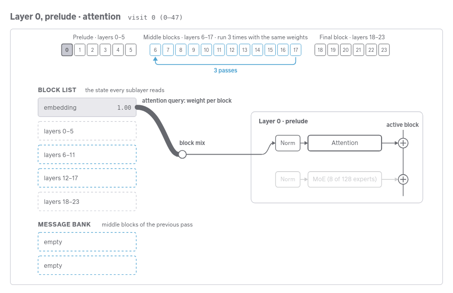
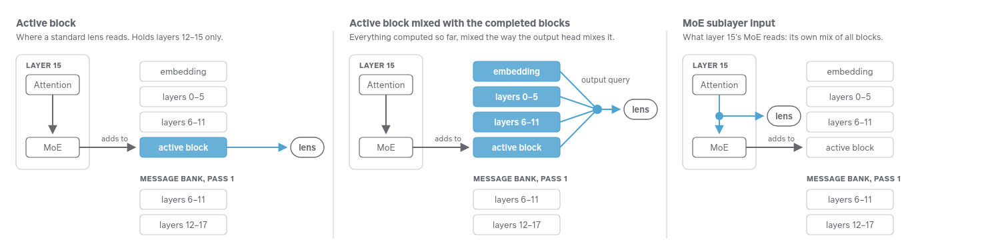
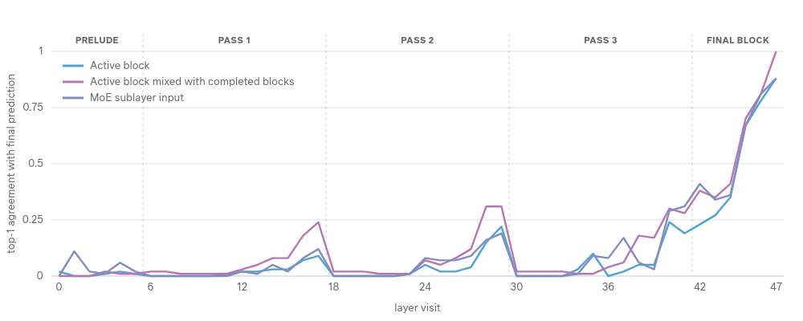

# Opening the box of Inkling 2 Mini using NNsight+NDIF

The **[National Deep Inference Fabric (NDIF)](https://ndif.us/)** is hosting Thinking Machines Lab's newly released **[Inkling 2 Mini](https://thinkingmachines.ai/news/inkling-2-mini/)** and **[TML-d24-varloop-research](https://huggingface.co/thinkingmachines/TML-d24-varloop-research)** looped transformer models for remote white-box inference. Through [NNsight](https://nnsight.net), researchers can inspect, patch, steer, and differentiate the models' internal activations across every loop iteration remotely without downloading the 26B weights or provisioning local GPUs. Grab a free API key at [login.ndif.us](https://login.ndif.us) to trace and patch activations on [NDIF](https://ndif.us/) by loading `"thinkingmachines/inkling-2-mini"` (or `"thinkingmachines/TML-d24-varloop-research"`) with `TransformersModel` (backward passes and direct parameter reads on NDIF require trusted access).

!!! abstract "TL;DR"
    - **Remote white-box access on NDIF:** **[Inkling 2 Mini](https://thinkingmachines.ai/news/inkling-2-mini/)** ([`thinkingmachines/inkling-2-mini`](https://huggingface.co/thinkingmachines/inkling-2-mini)) and **[TML-d24-varloop-research](https://huggingface.co/thinkingmachines/TML-d24-varloop-research)** ([`thinkingmachines/TML-d24-varloop-research`](https://huggingface.co/thinkingmachines/TML-d24-varloop-research)) are live on [NDIF](https://ndif.us/) for remote activation readout, patching, steering, and gradients via [NNsight](https://nnsight.net).
    - **Looped middle blocks & 6-layer attention residuals:** Rather than maintaining a single cumulative residual stream across a single pass, the 24 layers execute **48 layer visits** per token (looping 3 times over layers 6–17), freezing finished 6-layer sums into a list of **completed blocks** and resetting at each pass boundary into a gated **cross-pass message bank**.
    - **What changes for interpretability:** Hooking `llm.layers[i].output` only captures the current 6-layer active block in progress. Reading, patching, or steering the model's full state requires working across the active block, the completed blocks, and the cross-pass messages (`for _ in tracer.iter[:3]:`).

> **The Looped Lens Challenge:** Direct vocabulary unembedding reveals very little of what the three passes over the middle blocks compute before the final block. Alongside hosting these models on NDIF, we are launching an open community challenge to build new interpretability lenses for looped transformers. **Visit [ndif.us/looped-lens-challenge](https://ndif.us/looped-lens-challenge) for tasks, starter code, and submission details.**

<!-- more -->

## 1. The Models: Fixed-Loop and Variable-Loop

Thinking Machines Lab is releasing two 26B-parameter (3.4B active) Mixture-of-Experts models built on the same 24-layer looped, block-residual architecture:

- **[Inkling 2 Mini](https://thinkingmachines.ai/news/inkling-2-mini/)** ([`thinkingmachines/inkling-2-mini`](https://huggingface.co/thinkingmachines/inkling-2-mini)): the main release model, configured for a fixed 3-pass loop over its middle 12 layers (48 layer visits per token).
- **[TML-d24-varloop-research](https://huggingface.co/thinkingmachines/TML-d24-varloop-research)** ([`thinkingmachines/TML-d24-varloop-research`](https://huggingface.co/thinkingmachines/TML-d24-varloop-research)): a companion research model with the same 24-layer architecture, marked `is_varloop: true` in its checkpoint config so it can be run with a variable number of loop passes (`loop_num_passes` ≥ 1).

Compared to a standard transformer, their forward pass differs in two ways: **the middle 12 layers run repeatedly in a loop**, and **the residual stream is partitioned into discrete 6-layer blocks**.



On **[Inkling 2 Mini](https://thinkingmachines.ai/news/inkling-2-mini/)** (and **TML-d24-varloop-research** at its default 3-pass setting), the 24 stored layers execute across **48 layer visits** per token:

- **Prelude (layers 0–5):** run once (visits 0–5).
- **Middle Blocks (layers 6–17):** two 6-layer blocks, run **3 times in a loop** sharing the same weights (visits 6–41).
- **Final Block (layers 18–23):** run once (visits 42–47).

Instead of maintaining a single cumulative residual stream from layer 0 to layer 23, the model divides its forward state across two boundaries:

1. **Attention residuals over 6-layer blocks:** Following the attention residuals design ([Kimi Team, 2026](https://arxiv.org/abs/2603.15031)), sublayer outputs only add together inside a 6-layer window (the **active block**). At every 6-layer boundary (layers 0, 6, 12, and 18), that finished 6-layer sum is frozen and appended to a list of **completed blocks**, while the active block resets to zero for the next 6 layers. Every attention and MoE sublayer RMS-normalizes each available block, scores them against a learned query vector, and takes a softmax-weighted average as its input.
2. **Pass resets and cross-pass messages (every pass over the middle blocks):** When Pass 1 finishes layer 17 and loops back to layer 6 for Pass 2, the block list **resets back to the prelude outputs** (the embedding block and the layers 0–5 block). The two middle blocks from the finished pass (layers 6–11 and 12–17) are set aside into what we call the **message bank** (referred to collectively as the "message" in the [Inkling 2 Mini release post](https://thinkingmachines.ai/news/inkling-2-mini/); here, following the transformers code, a **message** refers to what an individual layer reads from that bank). During Passes 2 and 3, each middle-block layer reads four **messages** from the message bank using learned queries (one each for its attention query, key, and value inputs, plus one for its MoE input) and blends each message into the corresponding input *x* via two rank-64 `tanh` gates (*g*<sub>forget</sub> and *g*<sub>message</sub>, projected from [*x*, *message*]):

   <p align="center" style="font-size: 1.05em; margin: 0.75em 0;"><em>x</em> &larr; (1 &minus; <em>g</em><sub>forget</sub>) &odot; <em>x</em> + <em>g</em><sub>message</sub> &odot; <em>message</em></p>

### Variable Pass Counts

While **[Inkling 2 Mini](https://thinkingmachines.ai/news/inkling-2-mini/)** uses a fixed 3-pass schedule, **TML-d24-varloop-research** (`is_varloop: true`) can execute a different number of passes over the middle blocks (`loop_num_passes` ≥ 1, running 12 + 12 × `loop_num_passes` visits). It was trained with 1 to 5 passes and post-trained with 3, and [Thinking Machines Lab reports](https://thinkingmachines.ai/news/inkling-2-mini/) evaluations at up to 10 passes.

Each (layer, pass) visit keeps its own KV cache (48 cache layers at 3 passes), so Pass 2 only attends to earlier tokens' Pass 2 keys and values, and cross-pass information moves at the same token position through the cross-pass messages.

### Why This Model Is an Interesting Research Target

Most interpretability methods assume a single residual stream: one cumulative vector per token that every layer reads from and adds to, so the state after layer *L* can be decoded, patched, or steered at a single site. Here, no such single vector exists. At any visit, the model's representation is split across a list of 6-layer blocks and a cross-pass message bank, each sublayer dynamically chooses its own weighted mixture over depth, and the middle 12 layers iterate on their own representations three times in a single forward pass. Methods built on the single-stream assumption need to be rethought, and the loop raises questions that a standard feed-forward stack never encounters: what each pass computes, how one pass communicates with the next, and how to read out intermediate reasoning before the final layers. *(For a deep dive into several of these dynamics on Inkling 2 Mini, see Goodfire's companion research post, [Interpreting Inkling 2 Mini](https://www.goodfire.com/research/interpreting-inkling-2-mini/); below, we walk through how to inspect and intervene on the model yourself using NNsight and NDIF.)*

## 2. Demo: Where Is the Residual Stream?

A logit lens projects an intermediate state through the final normalization and unembedding matrix to see what token the model points toward at that depth. On a standard transformer, that intermediate state is simply the residual stream. Here, the architecture in Section 1 offers several distinct candidates at each of the 48 visits, and NNsight lets us compare them directly:

1. **Active block (`llm.layers[i].output`):** the standard layer-output hook site. In this model, the tensor a layer returns is the active block after that layer: the running sum of what the layers in the current 6-layer window have added so far, including this layer. It is neither the full forward state nor this layer's isolated contribution.
2. **Active block mixed with completed blocks:** the current active block together with the completed blocks from earlier depths, combined by `llm.final_input` (the block-mixing module the model itself applies right before its output head).
3. **MoE sublayer input (`llm.layers[i].post_attention_layernorm.input`):** the weighted mixture that the visit's MoE sublayer receives inside the layer, after attention and cross-pass message gating.



The example below is complete: without downloading the 26B weights locally, it loads the model's module tree, dispatches the trace to [NDIF](https://ndif.us/) with `remote=True`, and returns each readout's top predicted token across all 48 visits alongside the model's final prediction:

!!! note "Requires `transformers` 5.24.0 or later"
    Inkling 2 Mini is included in `transformers` starting with release 5.24.0:

    ```bash
    pip install nnsight==0.8.3 "transformers>=5.24.0"
    ```

```python
# Needs nnsight 0.8.3 and transformers 5.24.0 or later.
import torch, nnsight
from nnsight import CONFIG, TransformersModel

CONFIG.set_default_api_key("YOUR_NDIF_API_KEY")

# No dispatch: only the config, tokenizer and module tree are loaded locally.
MODEL_ID = "thinkingmachines/inkling-2-mini"
model = TransformersModel(MODEL_ID, task="image-text-to-text")
llm = model.model.language_model
prompt = "The capital of France is"

def lens(h):                                  # final norm + unembedding, last token
    h = llm.norm(h[:, -1]).to(model.lm_head.weight.dtype)
    return model.lm_head(h).argmax(-1)

def read(i, layer_out, mixed, moe_in):
    layer = llm.layers[i]
    hidden, blocks = layer.inputs[0][:2]      # active block and completed blocks entering the layer
    if i % 6 == 0:                            # this layer starts a new block: the entering block is now complete
        blocks = torch.cat([blocks, hidden.unsqueeze(-2)], dim=-2)
    moe_in.append(lens(layer.post_attention_layernorm.input))   # read in forward order
    out = layer.output
    layer_out.append(lens(out))
    mixed.append(lens(llm.final_input(blocks, out)[0]))

with model.trace(prompt, remote=True) as tracer:           # runs on NDIF
    layer_out, mixed, moe_in = list().save(), list().save(), list().save()
    for i in range(0, 6):                     # prelude
        read(i, layer_out, mixed, moe_in)
    for _ in tracer.iter[:3]:                 # three passes over the middle blocks
        for i in range(6, 18):
            read(i, layer_out, mixed, moe_in)
    for i in range(18, 24):                   # final block
        read(i, layer_out, mixed, moe_in)
    final = model.output.logits[0, -1].argmax(-1).save()
```

On `"The capital of France is"`, the model predicts `" Paris"`, and none of the three readouts surfaces `" Paris"` before visit 35 (late in Pass 3).

Running the same script over 100 CounterFact prompts (e.g., `"The mother tongue of Danielle Darrieux is"` → `" French"`) shows how often each readout's top token matches the model's final prediction at every visit:



Applied after the final layer, the active block mixed with the completed blocks (`llm.final_input`) reproduces the model's prediction on every prompt (1.00), while the other two reach 0.88. Across the looped middle blocks, however, all three readouts stay at or below 0.31: agreement climbs toward the end of each pass and drops back near zero whenever the next pass starts and hands those middle blocks into the message bank, before jumping sharply in the final block. That pattern immediately raises a deeper interpretability question: **what is actually being computed inside those three passes over the middle blocks, and what interpretable roles do the learned block-mixing queries and cross-pass message gates play in routing information from pass to pass?**

## 3. Working with the Model in NNsight

To explore those questions in NNsight, use `for _ in tracer.iter[:3]:` to step through the three passes over the middle blocks. Each decoder layer is called as `layer(hidden_states, block_states, messages)`, so its positional inputs `llm.layers[i].inputs[0]` hold the state entering that visit:

| State component | What it contains | Access in NNsight (`llm = model.model.language_model`, `layer = llm.layers[i]`) |
|---|---|---|
| **Active 6-layer block** | Running sum of the current 6-layer window only, shape `(batch, seq, hidden)` | `layer.output` after the layer has added its attention and MoE outputs (entering: `layer.inputs[0][0]`) |
| **Completed 6-layer blocks** | Finished 6-layer block sums from earlier depths, stacked as `(batch, seq, n_blocks, hidden)` | `layer.inputs[0][1]` |
| **Cross-pass messages** | The four messages (query, key, value, MoE) for this layer, `(batch, seq, 4, hidden)`; present in Passes 2 and 3 only | `layer.inputs[0][2]`, or `llm.message_input.output` |
| **Message bank** | The two middle blocks of the previous pass that the messages are read from | `llm.message_input.inputs[0][0]` (layers 6–11) and `llm.message_input.inputs[0][1]` (layers 12–17) |
| **Sublayer mixed input** | Sublayer input after mixing blocks and gating in the message | `layer.post_attention_layernorm.input` for the MoE (attention: `input_layernorm`, or `q_`/`k_`/`v_input_layernorm` in the full-attention layers) |
| **Block-mix modules** | The learned queries that weight the blocks | `layer.attention_input`, `layer.mlp_input`, `llm.final_input` (each has `.query`) |
| **Cross-pass gates** | Rank-64 gates blending each message into its input | `layer.q_message_gate`, `k_message_gate`, `v_message_gate`, `mlp_message_gate` (middle-block layers 6–17) |

Because there is no single cumulative residual tensor at layer *L*, standard interpretability operations act on the active block, the completed blocks, and the cross-pass messages together rather than on `layers[L].output` alone.

The snippets below reuse `model`, `llm`, and `prompt` from Section 2. Add `remote=True` to any trace to run it on [NDIF](https://ndif.us/), or load the weights locally with `TransformersModel(MODEL_ID, task="image-text-to-text", dispatch=True, dtype=torch.bfloat16, device_map="auto")`. The activation steering and gradient examples below require trusted access when run remotely on NDIF (because untrusted sandbox requests do not expose parameter weights or backward passes).

### Reading Intermediate States

`llm.layers[i].output` only holds the current 6-layer window in progress and resets every 6 layers. To inspect the full state at an intermediate visit, read the completed blocks and cross-pass messages alongside the active block, or read a sublayer's mixed input directly:

```python
with model.trace(prompt) as tracer:
    for _ in tracer.iter[2]:                  # Pass 3 (visits 30..41), layer 15
        layer = llm.layers[15]
        active   = layer.inputs[0][0].save()  # active block entering the layer (layers 12..14)
        blocks   = layer.inputs[0][1].save()  # completed blocks: embedding, layers 0-5, layers 6-11 of this pass
        messages = layer.inputs[0][2].save()  # query, key, value and MoE messages from Pass 2
        moe_in   = layer.post_attention_layernorm.input.save()
```

### Activation Patching

Overwriting `llm.layers[i].output` alone only replaces the active block, leaving downstream sublayers to continue reading the unpatched completed blocks and messages. To replace the complete forward state at a middle-block visit, overwrite the two previous-pass blocks in `llm.message_input` (which later layers in the same pass read their messages from) and the layer's three inputs where each is read:

```python
clean_prompt   = "Then, Henry and Phil were at the harbor. Phil gave a basket to"
corrupt_prompt = "Then, Henry and Phil were at the harbor. Henry gave a basket to"

def state_at_layer_12_pass_3(tracer):
    for _ in tracer.iter[18]:                 # call 18 of message_input: Pass 3, layer 12 (calls 0..11 are Pass 2)
        bank = llm.message_input.inputs[0][:2]
    for _ in tracer.iter[2]:                  # Pass 3, layer 12 (visit 36)
        state = llm.layers[12].inputs[0]
    return [*bank, *state]                    # previous-pass blocks (2), active block, completed blocks, messages

with model.trace(clean_prompt) as tracer:
    clean = [t.clone() for t in state_at_layer_12_pass_3(tracer)]
    clean = nnsight.save(clean)

with model.trace(corrupt_prompt) as tracer:
    for _ in tracer.iter[18]:                 # call 18 of message_input: Pass 3, layer 12 (calls 0..11 are Pass 2)
        for target, source in zip(llm.message_input.inputs[0][:2], clean[:2]):
            target[:] = source
    for _ in tracer.iter[2]:                  # Pass 3, layer 12 (visit 36)
        for target, source in zip(llm.layers[12].inputs[0], clean[2:]):
            target[:] = source
    patched_logits = model.output.logits[0, -1].save()
```

### Activation Steering

Because the block-mixing modules RMS-normalize each block before taking their softmax-weighted average, adding a steering vector to the active block alone rotates that one block without increasing its scale relative to the completed blocks. To steer the representation at a visit, add the vector to both the active block and the completed blocks:

```python
rome_id = model.tokenizer.encode(" Rome", add_special_tokens=False)[0]

with model.trace(prompt) as tracer:
    for _ in tracer.iter[1]:                  # Pass 2, layer 12 (visit 24)
        active, blocks = llm.layers[12].inputs[0][:2]
        direction = torch.nn.functional.normalize(model.lm_head.weight[rome_id], dim=0)
        steer = 8 * active.norm(dim=-1, keepdim=True) * direction
        active += steer
        blocks += steer.unsqueeze(-2)
    p_rome = model.output.logits[0, -1].softmax(-1)[rome_id].save()
```

### Gradients

Each visit's `llm.layers[i].output` is a distinct tensor, so `.grad` gives a separate gradient for each pass. Freeze the model parameters first so the backward pass does not allocate gradients for every weight:

```python
paris_id = model.tokenizer.encode(" Paris", add_special_tokens=False)[0]
model.requires_grad_(False)

with model.trace(prompt) as tracer:
    llm.embed_tokens.output.requires_grad_(True)       # start the graph at the embeddings
    visit_outs = [llm.layers[15].output for _ in tracer.iter[:3]]
    metric = model.output.logits[0, -1, paris_id]
    grads = nnsight.save([])
    with metric.backward():
        for v in reversed(visit_outs):        # gradients arrive in reverse forward order
            grads.append(v.grad.clone())
```

### Changing the Pass Count (TML-d24-varloop-research)

On a locally loaded **TML-d24-varloop-research** model (`"thinkingmachines/TML-d24-varloop-research"`), the pass count is read from `llm.config.loop_num_passes` at the start of every forward pass (whereas remote requests run with the pass count configured on the hosted deployment):

```python
# Run TML-d24-varloop-research locally with 1, 2, or 3 passes over the middle blocks:
for p in [1, 2, 3]:
    llm.config.loop_num_passes = p
    with model.trace(prompt):
        logits = model.output.logits[0, -1].save()
```

## 4. Open Questions and the Looped Lens Challenge

Having both models live on [NDIF](https://ndif.us/) makes it easy to start probing how a looped, block-residual transformer organizes its computation:

- **How representations evolve across loop passes:** The middle blocks (layers 6–17) run three times with shared weights while resetting the residual block list at each pass boundary. What computation happens in Pass 1 versus Pass 2 versus Pass 3?
- **Depth-attention routing (`attention_input`, `mlp_input`, `final_input` queries):** Instead of reading a uniform residual sum, every sublayer dynamically weights earlier 6-layer blocks using learned query vectors. How do sublayers route information across depth at different stages of the forward pass?
- **Cross-pass communication via the message bank:** Everything Pass 1 communicates to Pass 2 (and Pass 2 to Pass 3) flows through `llm.message_input` and the rank-64 message gates (`q_`/`k_`/`v_`/`mlp_message_gate`). What information is selected and gated from one pass to the next?
- **Decoding without a single residual stream:** What is the right way to adapt tools like the logit lens, tuned lenses, or Jacobian lenses (J-Lens) when representations are split across depth blocks and loop iterations?

The **Looped Lens Challenge** takes up that last question directly: **build a lens that decodes what the loop over the middle blocks computes before the model writes it out.** Visit the challenge website at [ndif.us/looped-lens-challenge](https://ndif.us/looped-lens-challenge) for the evaluation tasks, starter code, and submission details!
